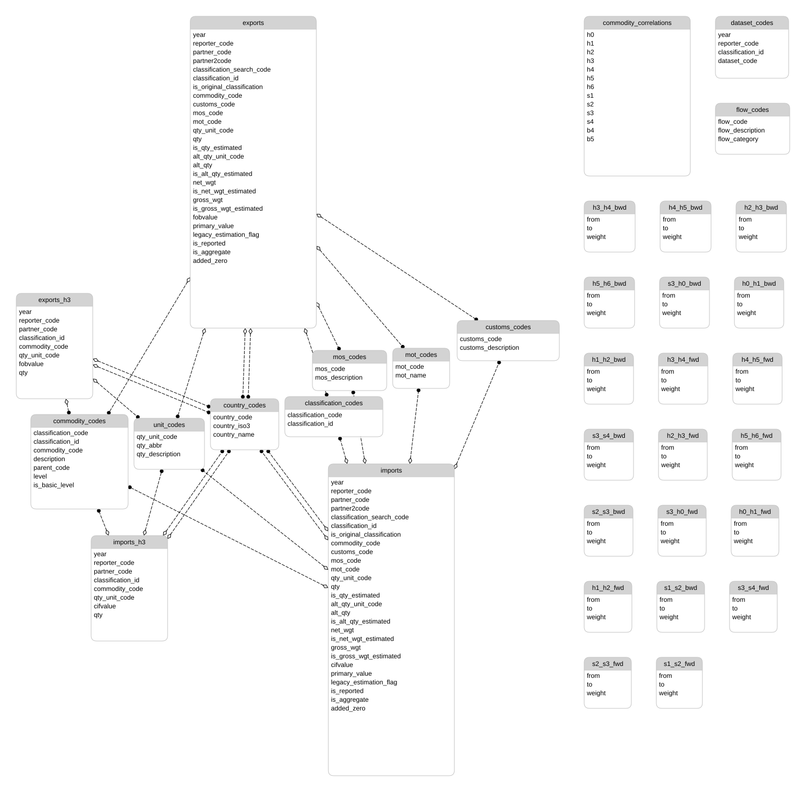

# UN COMTRADE Datasets in PostgreSQL

[](https://www.buymeacoffee.com/pacha)

These script download the UN Comtrade Plus dataset from 1962 to 2024.

The downloaded files were organized into a PostgreSQL database.

To add to raw COMTRADE data I provide a script based on Hausman Lab (Harvard) to convert all records to HS07 (or H3) from the
original classifications provided by each reporter (e.g. HS92, SITC rev 2, etc).

The SQL dump in the releases page of this repository does *not* include the original imports and exports table. These cannot
be reshared as a result of the COMTRADE data release license.

Running these scripts took around three days to complete, mostly because the downloads from UN Comtrade are slow and the
validation and cleaning steps are time consuming.

Clean Comtrade database diagram:



## Use this data

Download all of the ZIP parts from the [releases page](https://github.com/pachadotdev/comtrade-database-postgresql-public/releases/tag/sql-dump). Unzip *comtrade.zip*, then restore the database with

```bash
psql -h localhost -p 5432 -U REPLACE_USER -v ON_ERROR_STOP=1 \
    -c 'DROP DATABASE IF EXISTS comtrade;' \
    -c 'CREATE DATABASE comtrade OWNER REPLACE_USER;'

pg_restore -h localhost -p 5432 -U REPLACE_USER -d comtrade \
    --no-owner --no-acl -v comtrade.dump
```

## Units

The columns `fobvalue` and `cifvalue` are in USD million.

## Re-create the full database

1. Run `Rscript 01-download-data.r` (slow)
2. Run `Rscript 02-copy-to-sql.r`
3. Run `03-convert-flows.sh`

Step 1 requires a UN COMTRADE token, which are usually ony available for paid accounts. Check with your university's library
for access.

## Note to myself

Update the SQL dump with

```bash
pg_dump -Fc -d comtrade \
  --exclude-table=imports \
  --exclude-table=exports \
  -f comtrade.dump
```
